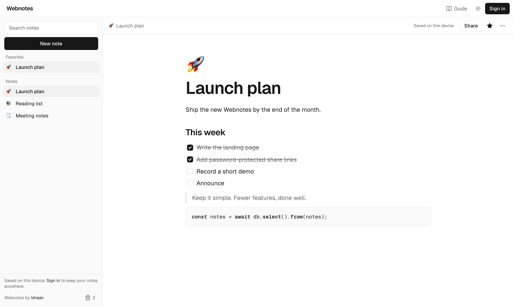
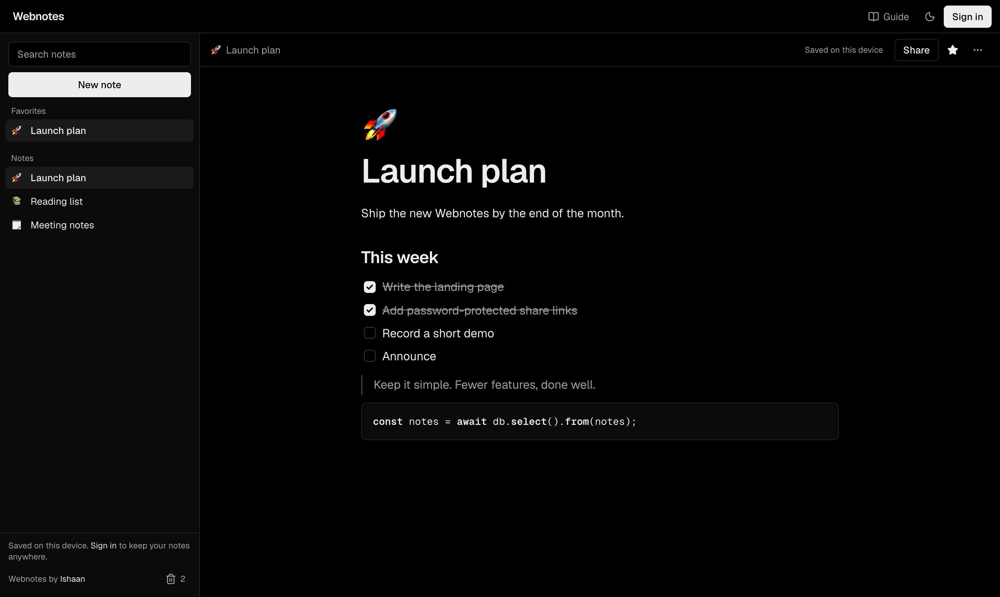
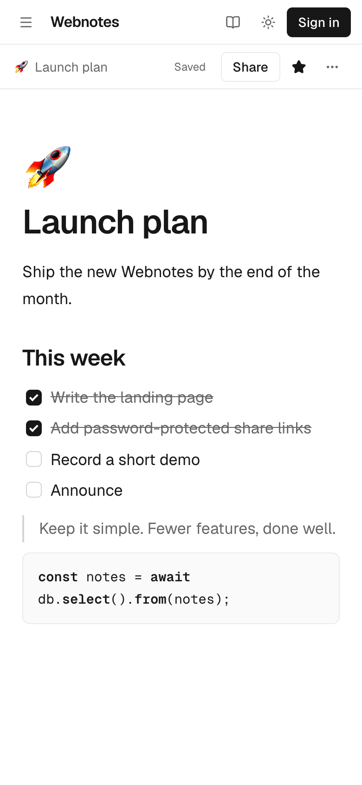
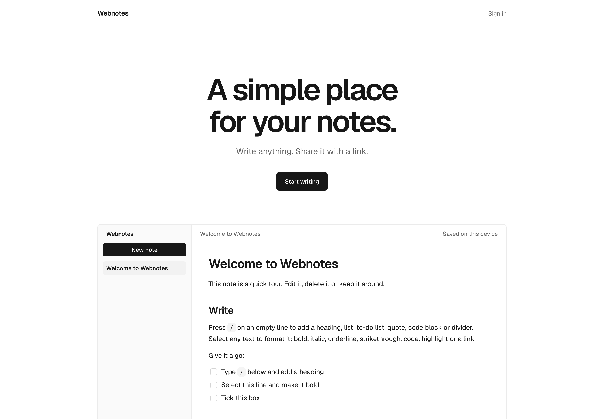
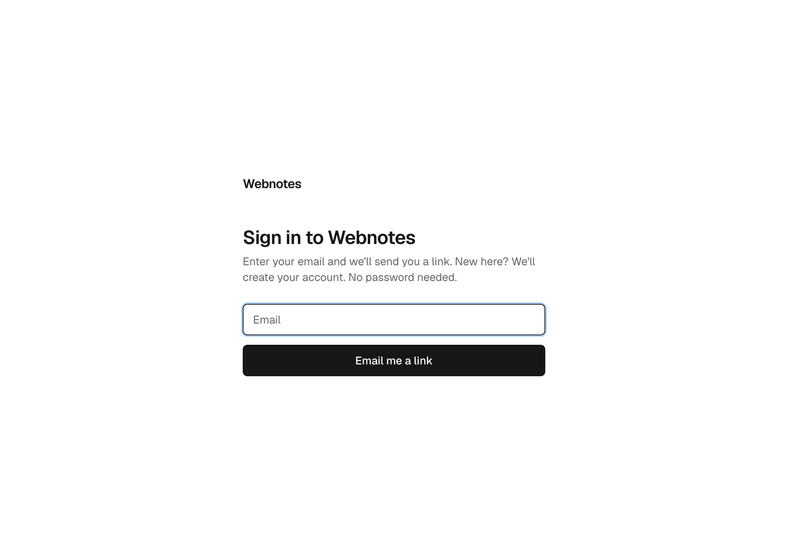
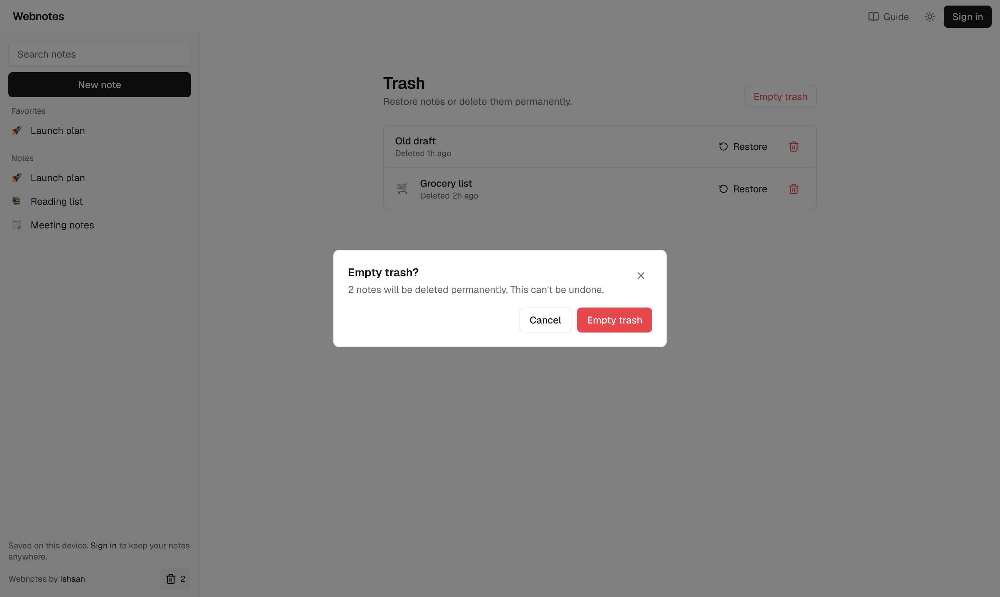

# Webnotes 3.0

A fast, private markdown notebook with one-click sharing. Write in a Notion-style editor, keep notes on your device or in your account, and share any note as a read-only link.

Built with **Next.js 16**, **Tiptap 3**, **Drizzle** and **Tailwind 4**, with **Neon** as the only backend.



## Features

- **Notion-style editor.** Type `/` for headings, lists, to-dos, quotes, code blocks and dividers. Select text to bold, italic, underline, strike, highlight, code or link it. Notes are stored as Markdown.
- **Works without an account.** Guests get the full workspace on `localStorage`. An account is only needed for sharing and images, and the notes written as a guest can be imported on sign-up.
- **Passwordless sign-in.** Email magic links, no passwords to manage.
- **Share by link.** Read-only public links with an optional password and expiry, and a reset button that kills the old address.
- **Images.** Paste, drag and drop, or `/image`, stored in a private bucket.
- **Live sync.** The sidebar and open note update across your tabs, and public pages follow the note live.
- **Organize.** Favorites, title search, and a trash with restore and permanent delete (always confirmed).
- **Dark mode, mobile friendly, accessible** dialogs and menus.

<table>
  <tr>
    <td></td>
    <td width="220"></td>
  </tr>
  <tr>
    <td></td>
    <td></td>
  </tr>
  <tr>
    <td colspan="2"></td>
  </tr>
</table>

## Routes

| Route | What it is |
|---|---|
| `/` | Signed in: redirects to `/notes`. Signed out: redirects to `/home`. |
| `/home` | Landing page with a live playground |
| `/notes` | The app (guest workspace when signed out) |
| `/notes/trash` | Trash |
| `/auth` | Sign in with an email link |
| `/s/[token]` | Public, read-only shared note |

## Neon services

| Service | Used for |
|---|---|
| **Postgres** | Notes, share settings, onboarding flag (Drizzle + Neon's serverless HTTPS driver, which works where port 5432 is blocked) |
| **Auth** (managed Better Auth) | Magic-link sign-in and sessions; users live in the `neon_auth` schema of the same database |
| **Realtime** | Live sidebar and note sync across tabs, live public share pages |
| **Object Storage** | Image uploads, private bucket behind an authorized URL |

Postgres and Auth are required. Realtime and Storage are optional and switch on when their env vars are present.

## Set up with an AI agent

Using Claude Code, Cursor, Codex or a similar coding agent? Paste this prompt into it, in the folder where you want the project.

````text
Set up Webnotes on this machine and get it running locally.

Repo: https://github.com/ishaanbedi/webnotes

Do this in order, and tell me briefly what you did after each step:

1. Check prerequisites: Node.js 20 or newer, npm, git. Install the Neon CLI if it is
   missing (`npm i -g neon`). If any install needs my permission, ask me first.
2. Clone the repo, `cd webnotes`, run `npm install`, and read README.md fully, especially
   the "Neon configuration" section. Also read AGENTS.md: this Next.js version has breaking
   changes, so check node_modules/next/dist/docs/ before changing any code.
3. Neon project: run `neon login` (I will complete the browser login). Then ask me whether to
   link an existing Neon project or create a new one. Never modify or delete an existing
   project's data or settings without asking me first.
4. Make sure Neon Auth (managed Better Auth) is enabled for the project, then create
   `.env.local` from `.env.example` and fill in `DATABASE_URL`, `NEON_AUTH_BASE_URL`
   (from `neon neon-auth status`) and `NEON_AUTH_COOKIE_SECRET` (`openssl rand -base64 32`).
   Keep `NEXT_PUBLIC_APP_URL=http://localhost:3000`.
5. Sign-in is by email magic link. Check `neon neon-auth plugins list`:
   - Email & Password should be disabled.
   - Magic Link must be enabled. The CLI cannot change this, so if it is off, stop and tell
     me exactly where to click in the Neon Console (Settings, Better Auth, Magic Link, Enable
     Magic Link, and turn on Allow New User Registration), then wait for me.
   - Run `neon neon-auth domain allow-localhost get` and enable it if it is off.
6. Run `npm run db:migrate`, then `npm run db:check`. Fix any problem before continuing.
7. Optional, ask me first: Realtime (`neon realtime enable && neon env pull --service
   realtime`) and image storage (`neon deploy`, then
   `APP_ORIGIN=http://localhost:3000 node --env-file=.env.local scripts/storage-cors.mjs`).
   Skip whichever I decline. The app works without both.
8. Run `npm run typecheck`, then start `npm run dev`. Open http://localhost:3000 and confirm
   that / redirects to /home, /notes loads, and /auth shows the email field.
9. Tell me to request a sign-in link at /auth and open the email link in the same browser.
   Confirm I land signed in on /notes.

Rules: never commit or print secrets, never commit `.env.local`, never run destructive
commands (drop, delete, reset, force push) without asking, and stop and ask if something
does not match these steps instead of guessing.
````

## Setup

```bash
npm i -g neon && neon login && neon link     # Neon CLI
cp .env.example .env.local                   # then fill it in, see below
npm install
npm run db:migrate                           # create tables (over HTTPS, port 443)
npm run dev
```

1. **Postgres + Auth:** create the project (Postgres + Better Auth enabled), set `DATABASE_URL`, `NEON_AUTH_BASE_URL`, and `NEON_AUTH_COOKIE_SECRET` (`openssl rand -base64 32`).
2. **Realtime (optional):** `neon realtime enable && neon env pull --service realtime`. Limited regions.
3. **Storage (optional):** `neon deploy` creates the bucket (`S3_BUCKET`, default `uploads`) from `neon.ts` and writes the `AWS_*` vars. Then allow browser uploads:
   `APP_ORIGIN=http://localhost:3000 node --env-file=.env.local scripts/storage-cors.mjs`

Scripts: `dev`, `build`, `start`, `typecheck`, `db:generate`, `db:migrate`, `db:check`, `db:studio`.

## Neon configuration

Everything the app needs from Neon, what each setting does, and how to set it. Run the CLI commands from the project folder after `neon link` (or add `--project-id` and `--branch`).

### Environment variables

| Variable | Required | What it is | How to get it |
|---|---|---|---|
| `DATABASE_URL` | yes | Postgres connection string | Neon Console, Connect, or `neon env pull` |
| `DATABASE_URL_POOLED` | no | Pooled string, used at runtime when set | Same place |
| `DATABASE_URL_UNPOOLED` | no | Direct string, used by `db:migrate` when set | Same place |
| `NEON_AUTH_BASE_URL` | yes | Your Neon Auth endpoint | Console, Settings, Better Auth, or `neon neon-auth status` (Base URL) |
| `NEON_AUTH_COOKIE_SECRET` | yes | Signs the session cookies, also used for share-link unlock cookies | `openssl rand -base64 32`. Keep it secret and stable: changing it signs everyone out |
| `NEON_REALTIME_URL`, `NEON_REALTIME_SECRET`, `NEON_REALTIME_DB` | no | Live sync | `neon realtime enable && neon env pull --service realtime` |
| `AWS_ENDPOINT_URL_S3`, `AWS_REGION`, `AWS_ACCESS_KEY_ID`, `AWS_SECRET_ACCESS_KEY`, `S3_BUCKET` | no | Image uploads | `neon deploy` creates the bucket from `neon.ts` and writes these |
| `NEXT_PUBLIC_APP_URL` | no | Public origin used to build share links | Your site URL, e.g. `https://notes.example.com`. Defaults to the current origin |

Without the Realtime variables the app still works, it just doesn't live-update across tabs. Without the storage variables, image uploads are switched off.

### Neon Auth settings

Check the current state any time:

```bash
neon neon-auth status                 # base URL, branch, database
neon neon-auth plugins list           # what is enabled
```

| Setting | Value | Why | Where |
|---|---|---|---|
| **Magic Link** | enabled | The only sign-in method | Console: Settings, Better Auth, Magic Link, Enable Magic Link (no CLI command for this one) |
| Link lifetime | your choice, 5 to 15 minutes is typical | How long an emailed link works | Same screen |
| **Allow New User Registration** | on | The first link also creates the account. Off means only existing users can sign in | Same screen |
| **Email & Password** | disabled | No passwords exist in the app. Disabling closes those endpoints | Console, or `neon neon-auth config email-password update --enabled false` |
| **Trusted domains** | your production domain | Auth only redirects to trusted domains | `neon neon-auth domain add https://notes.example.com` |
| **Allow localhost** | on for development | Lets `http://localhost:3000` sign in. Turn off for production if you like | `neon neon-auth domain allow-localhost enable` (or `disable`) |
| **Email provider** | shared (dev) or custom SMTP (production) | Who sends the sign-in emails | See below |

Check trusted domains with `neon neon-auth domain list`.

**Email provider.** The shared mailer is for development: it is rate limited and its mail often lands in spam. Before launch, add your own SMTP sender:

```bash
neon neon-auth config email-provider update \
  --type standard --host smtp.example.com --port 587 \
  --username USER --password PASS \
  --sender-email no-reply@example.com --sender-name Webnotes
neon neon-auth config email-provider test     # sends a test message
```

### Postgres

`npm run db:migrate` creates the `notes` and `user_profiles` tables. After changing `src/db/schema.ts`, run `npm run db:generate && npm run db:migrate`. `npm run db:check` verifies the connection. The app only reads `neon_auth.*` through Neon Auth, except during account deletion (see below).

### Realtime

Enable it per project with `neon realtime enable` (limited regions), then pull the variables. Queries are sealed on the server with the signed-in user's id, so a browser can subscribe but can't change what it receives.

### Object Storage

`neon deploy` provisions the bucket declared in `neon.ts`. Browsers upload straight to the bucket with presigned URLs, so the bucket needs a CORS rule for your origin:

```bash
APP_ORIGIN=https://notes.example.com node --env-file=.env.local scripts/storage-cors.mjs
```

Run it again for each origin you serve from (including `http://localhost:3000` for development).

### Common problems

| Symptom | Likely cause |
|---|---|
| Sign-in email never arrives | Magic Link not enabled, or the shared mailer is rate limited or in spam. Set up SMTP |
| Link opens `/notes` but you stay signed out | Open it in the same browser you requested it from. Check `NEON_AUTH_COOKIE_SECRET` is set. Safari drops `Secure` cookies on plain `http://localhost`, so use Chrome or Firefox in development |
| "Invalid origin" or redirect errors | Domain missing from trusted domains |
| Image upload fails in the browser | Bucket CORS not set for this origin |
| Notes don't update across tabs | Realtime variables missing or Realtime not enabled |

## Sign-in (passwordless)
Accounts use **email links only**: no passwords anywhere in the app. Neon Auth sends the email with its built-in mailer, so there is no email provider in this repo. One-time setup in the Neon Console: **Settings, Better Auth, Magic Link, Enable Magic Link** (pick a link lifetime, and turn on *Allow New User Registration* so the first link also creates the account). To close the password endpoints completely, also switch off the **Email & Password** sign-in method there. The built-in mailer is meant for development; before launch add your own SMTP sender in the Console's email provider settings.

The link returns to `/notes?neon_auth_session_verifier=…`. Neon's middleware only exchanges that token when an OAuth challenge cookie exists, which magic links never set, so `src/proxy.ts` completes the exchange itself.

## Guest mode
No account is needed to use the app. Signed-out visitors get the full workspace at `/notes` running on `localStorage` (notes, favorites, trash, search, tour). It asks for an account only when something needs the server: **sharing** and **images**. After sign-up, the app offers to import the notes written as a guest (`importNotes` in `src/lib/actions.ts`).

## Sharing
Notes are private to their owner. Turn on **Share** to get a read-only link, with controls:
- on/off (turning it off, or trashing the note, also clears its password and expiry)
- optional **expiry** (1 hour, 1 day, 7 days, 30 days)
- optional **password** (scrypt hash; unlocking sets a signed, httpOnly cookie that is invalidated when the password changes or the link is reset)
- **reset** the link to get a new address and kill the old one

There are no invitations and no email sending.

## Onboarding
New users see a short tour in a modal. The flag lives in `user_profiles.onboarded` (our own table, since `neon_auth.user` is managed by Neon). The navbar's **Guide** button reopens it any time.

## Deleting an account
Account menu, then **Delete account**. It needs a sign-in from the last 24 hours plus the account email typed out, then permanently removes the user's notes, uploaded images, profile row and Neon Auth login (`src/lib/account-actions.ts`). It first tries Neon Auth's `deleteUser`; if account deletion isn't enabled for the project it removes the user's rows from the `neon_auth` schema directly.

## Security model
- `src/proxy.ts` refreshes the session and completes magic-link sign-in. `/notes` is open to guests (local-only workspace), but every server action and route handler re-checks identity and ownership via `getAccess()`; missing and forbidden notes are both 404.
- Realtime queries are **sealed on the server** with the verified user id; browsers can subscribe but not alter the query, and sealed queries expire in ~60 s (re-authorized on every renewal, so revoking access cuts the stream off).
- Images: private bucket, PNG/JPEG/WebP/GIF only (no SVG), 8 MB cap enforced in the presigned PUT, served via `/api/files/...` which authorizes per request (the owner, or a valid and unlocked public link).
- Public links: 192-bit tokens, `noindex`, `no-referrer`, `no-store`; trashing a note revokes its link and deletes its images on permanent delete.
- zod validation everywhere, 1 MB note cap, in-memory rate limits (swap for Redis if multi-instance), HSTS/nosniff/frame-deny headers. No CSP yet.

## Schema changes
Edit `src/db/schema.ts`, then `npm run db:generate && npm run db:migrate`. `npm run db:check` verifies connectivity.
